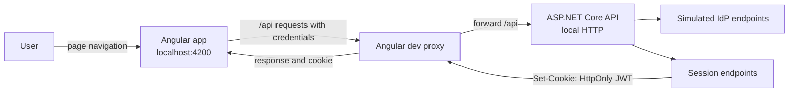
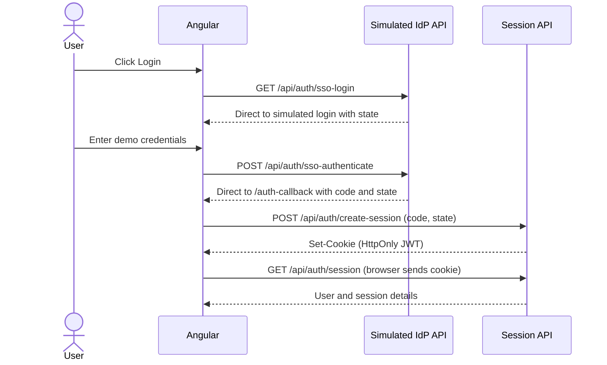

# SSO Session Management Lab architecture

## Scope and trust boundaries

This is a local learning simulator, not an OAuth 2.0 or OpenID Connect provider.
The Angular application and ASP.NET Core API run locally. The API hosts the
simulated identity-provider endpoints and the application-session endpoints,
but those responsibilities remain logically separate: simulated IdP endpoints
authenticate demo credentials and issue one-time authorization codes; session
endpoints validate those codes and issue application JWTs.

The browser is not trusted with the JWT. It receives the JWT only as an
`HttpOnly` cookie and never reads or stores it in JavaScript, local storage, or
session storage. Demo credentials and signing configuration are for local
development only. In-memory authorization-code and state storage is suitable
only for this single-instance learning application; it is not durable or
appropriate for production.

## Local components



The development proxy makes API calls appear same-origin to the browser and
avoids adding CORS configuration just for local development. The browser
automatically includes matching cookies on requests; Angular enables this with
`withCredentials`. The proxy forwards the cookie to the API. Cookie host scope
does not include a port, so local ports do not create separate cookie
boundaries.

### Local Nginx reverse proxy (alternative to `ng serve`)

[`nginx/conf/nginx.conf`](../nginx/conf/nginx.conf) runs a native Windows
Nginx on `http://localhost:8080` that serves the production Angular build and
proxies `/api/` to the API on `127.0.0.1:5208`. This is the same single-origin
layout that later phases containerize.

```powershell
cd frontend\sso-session-ui; npx ng build; cd ..\..
dotnet run --project backend\SsoSession.Api --launch-profile nginx
.\nginx\nginx.ps1            # start (also: -Action test | reload | stop)
```

- The `nginx` launch profile sets `Frontend__BaseUrl=http://localhost:8080`.
  The API builds its IdP redirect and callback URLs from that value, and the
  Angular app rejects redirects to any other origin. Use the `http` profile
  for `ng serve` on port 4200.
- `try_files ... /index.html` serves Angular's client-side routes.
- `/api/` responses get `Cache-Control: no-store`; `index.html` gets
  `no-cache`; hashed JS/CSS can be cached.
- The access log records `$uri` (no query string), so authorization codes and
  state values in callback URLs are never written to disk. `Referrer-Policy:
  no-referrer` keeps them out of `Referer` headers.
- Nginx passes `Cookie` and `Set-Cookie` through unchanged and does not log
  them. Cookie attributes are still set by the API.

## Authentication and session flow

1. The user selects **Login** in the Angular app.
2. The app starts the simulated sign-in through `GET /api/auth/sso-login`.
   The API creates a cryptographically random, short-lived state value, stores
   the pending transaction, and directs the browser to the Angular simulated
   IdP login route with that state.
3. The simulated IdP page collects the demo username and password. It submits
   them and the state to `POST /api/auth/sso-authenticate`. The API validates
   the demo credentials and pending state, then issues a random, short-lived,
   single-use authorization code bound to the authenticated user and state.
4. The simulated IdP directs the browser to Angular's `/auth-callback` route
   with the authorization code and state. The code is a temporary hand-off
   value, not the application JWT.
5. The callback sends the code and state to `POST /api/auth/create-session`.
   The API validates the state and code, checks their binding and expiry, and
   consumes the code so it cannot be exchanged a second time.
6. The API creates a signed JWT with user/session claims and a six-minute
   expiration, then returns it only in an `HttpOnly` authentication cookie.
   The response body contains no JWT.
7. Angular calls `GET /api/auth/session`. The JWT bearer handler reads the
   token from the cookie and validates its signature, issuer, audience, and
   expiration. The API returns non-secret session details for the dashboard.
8. While the current session is valid, `POST /api/auth/refresh-session` may
   replace the cookie with a newly signed JWT and a new expiration. The
   refresh endpoint must apply an explicit maximum session-age policy; a
   production system would normally use carefully managed refresh tokens and
   additional protections instead.
9. `POST /api/auth/logout` clears the cookie using the same cookie name, path,
   and relevant attributes. Subsequent session requests are unauthenticated.



## What the terms mean

- **Identity Provider authentication:** the simulated IdP checks the demo
  credentials. It does not establish a production identity or federate with an
  external provider.
- **Authorization code:** a short-lived, single-use value that represents the
  successful simulated IdP sign-in. It is exchanged by the API, not used as
  the application session.
- **State:** a random value associated with the pending sign-in and returned
  unchanged through the callback. Binding it to the code helps reject forged
  or mismatched callbacks.
- **SSO callback:** the Angular route that receives the temporary code and
  state and asks the API to create the app session.
- **Application session:** the API-authenticated period represented here by a
  signed, short-lived JWT.
- **JWT token:** a signed set of claims validated by the API. A signature
  protects token integrity; it does not encrypt the token contents.
- **Authentication cookie:** the browser-managed, `HttpOnly` transport/storage
  mechanism for the JWT. JavaScript cannot read an `HttpOnly` cookie, but the
  browser can attach it automatically to matching requests.

## Cookie and expiration behavior

For local HTTP development, the cookie is `HttpOnly`, `SameSite=Lax`,
`Secure=false`, has `Path=/`, and has no `Domain` attribute. `Secure=false` is
only for local HTTP; deployed environments must use HTTPS and `Secure=true`.
`SameSite=Lax` helps limit cross-site cookie sending but is not a complete
CSRF defense. Cookie-authenticated state-changing endpoints need appropriate
CSRF protection.

JWT expiration, cookie expiration, browser storage, and API validation are
separate: the cookie's lifetime should match the JWT's six-minute lifetime;
the browser stores and transmits the cookie according to its attributes; and
the API must still validate the JWT on every protected request. An expired
cookie may stop being sent, while a copied or otherwise present expired JWT
must still be rejected by the API. Angular handles an API `401` by clearing
local session display state and returning the user to the login page.

## Important limitations

This simulator does not implement the full security guarantees of a real
OpenID Connect provider. It does not provide external identity verification,
discovery or signing-key rotation, production-grade client registration,
distributed transaction storage, robust abuse controls, or production refresh
token lifecycle management. Do not reuse its demo credentials, signing key,
or HTTP cookie settings in a deployed application.

## Intended local project layout

```text
sso-session-lab/
  frontend/
    sso-session-ui/
  backend/
    SsoSession.Api/
  docs/
    architecture.md
    authentication-flow.md
    cookie-lifecycle.md
    troubleshooting.md
  README.md
```

The backend targets .NET 10 LTS. The checked environment has .NET SDK 10.0.404
and ASP.NET Core runtime 10.0.15 installed. Angular CLI 21.2.30 is installed
globally and is compatible with the installed Node.js 24.7.0 and npm 11.5.1.
